# PULP — Coffee Atelier

> **Coffee is a fruit. We treat it like one.**
> An art-directed, editorial website for an independent specialty coffee shop — built with Next.js, GSAP and Tailwind CSS.

PULP is a concept brand: a contemporary specialty coffee destination with an urban, premium personality. Instead of the usual brown-and-beige coffee template, the identity starts from the **coffee cherry** (a red fruit) and borrows the language of an independent magazine — each season is an "Issue", each section a "chapter".

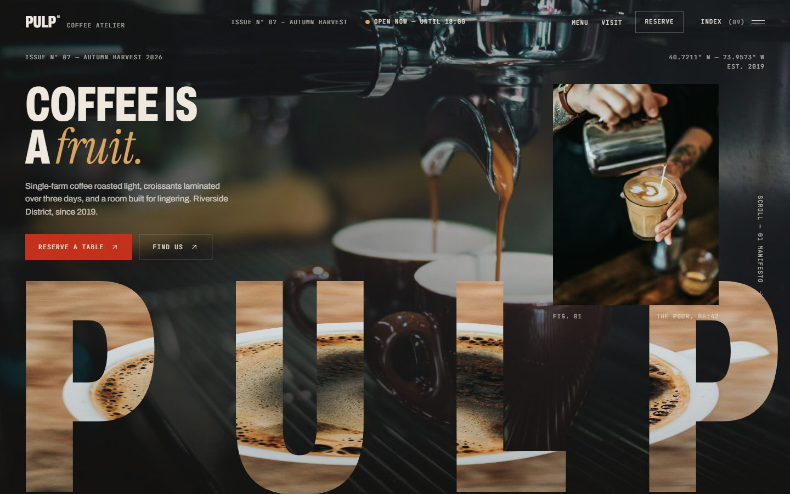

## Highlights

| | |
|---|---|
| 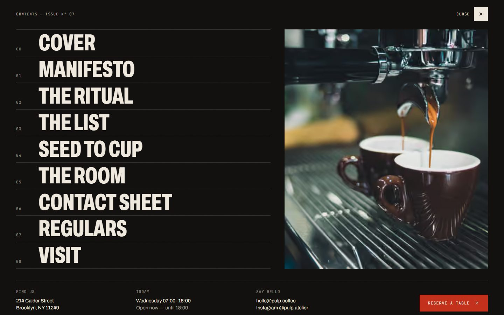 | 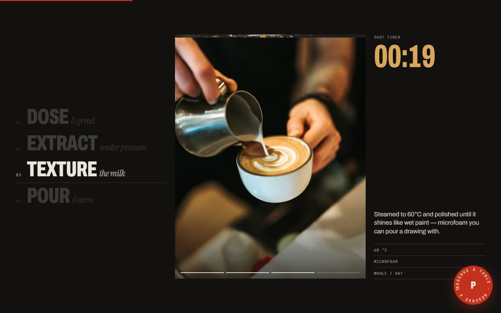 |
| Full-screen chapter index with image previews | Pinned "Ritual" scene — a shot timer scrubs 00:00 → 00:28 |
| 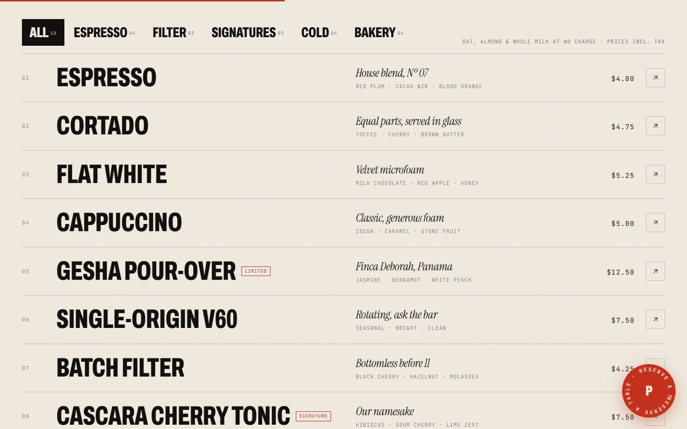 | 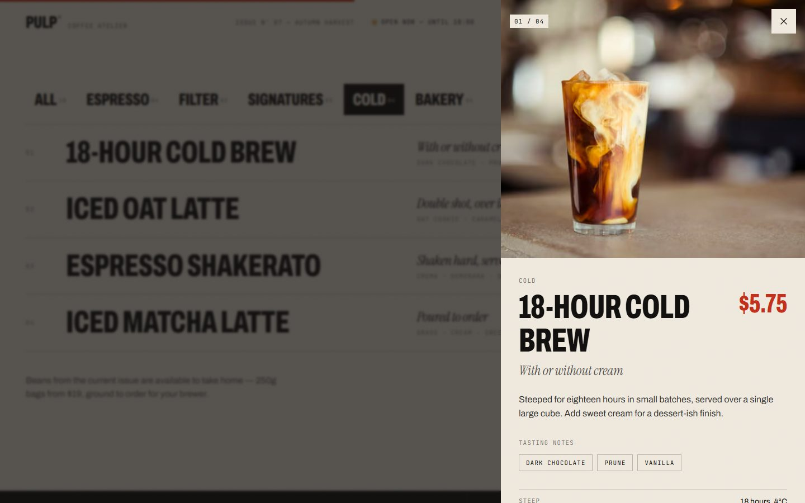 |
| Typeset menu with category filtering | Product detail drawer with tasting notes |
| 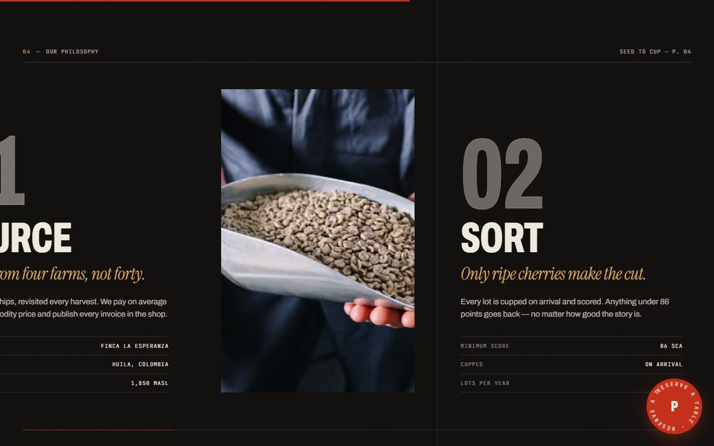 | 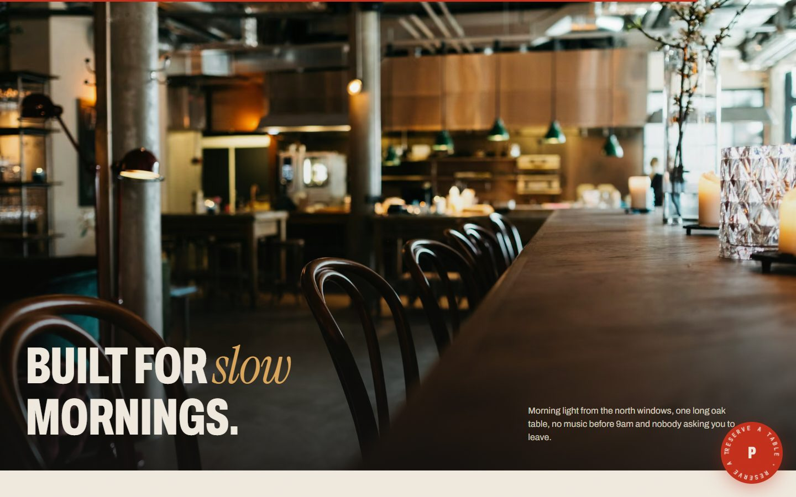 |
| Horizontal "Seed to Cup" journey | A framed window that opens to full-bleed |
| 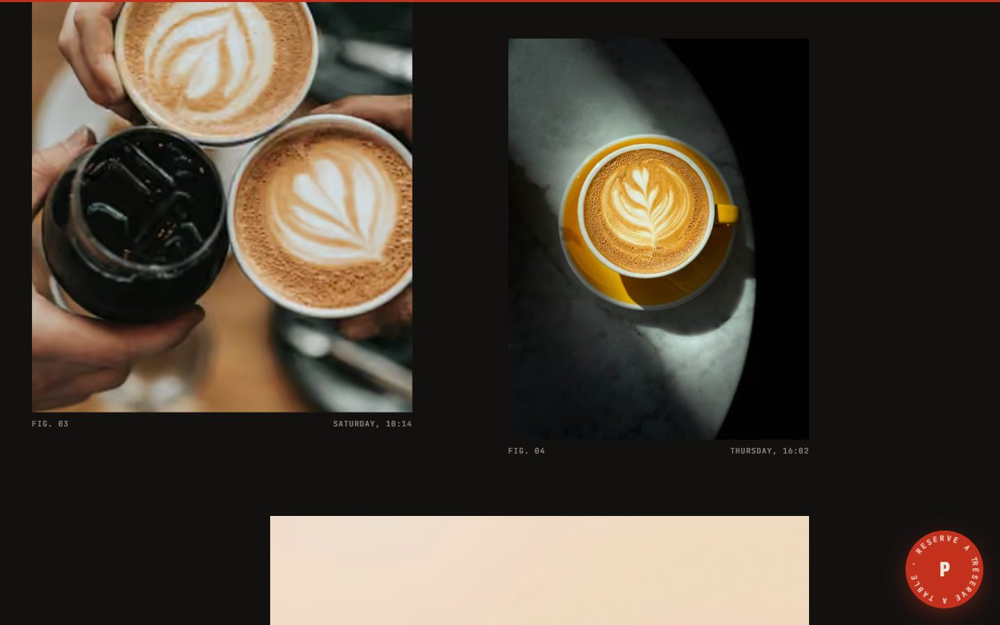 | 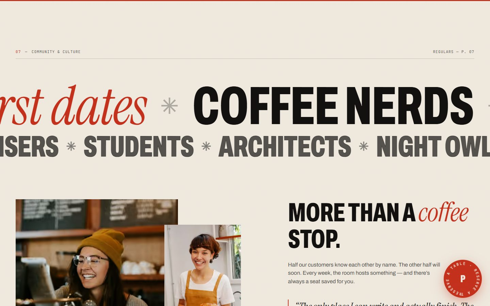 |
| Contact-sheet gallery with parallax + lightbox | Marquee, weekly programme, Instagram strip |
| 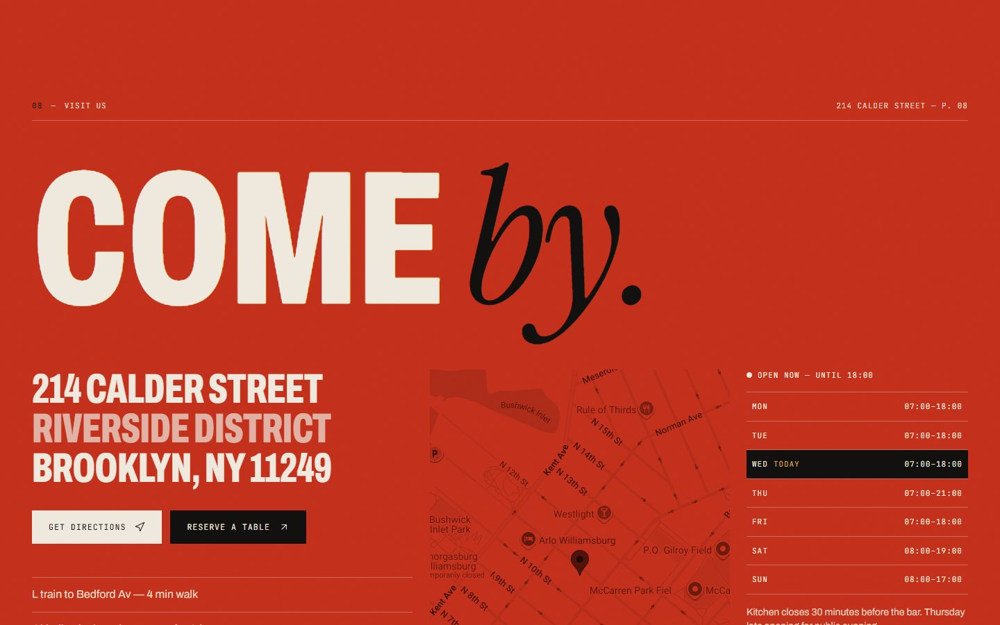 | 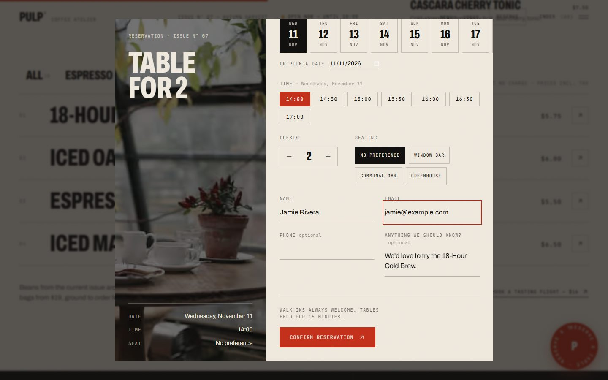 |
| Visit page: map, live hours, contact form | Table reservation modal with `.ics` calendar file |

**Mobile** is designed separately, not just shrunk:

<p>
  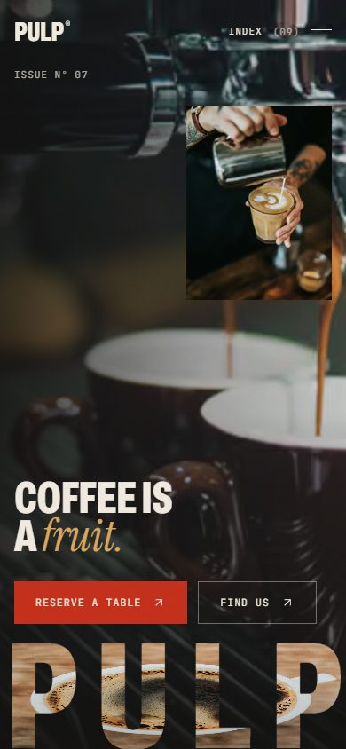
  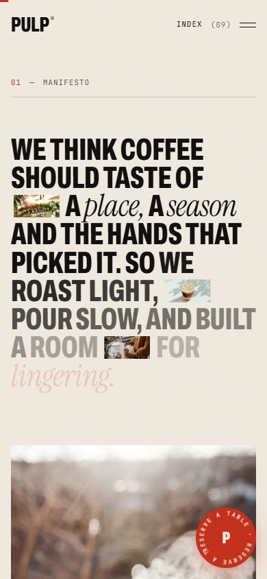
  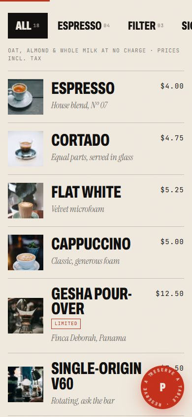
</p>

## Features

**Experience**
- Cinematic preloader curtain and a hero with a crema-textured, full-width wordmark
- Scroll-driven storytelling: word-by-word manifesto, pinned ritual, horizontal track, expanding room window
- Headline line reveals, clip-path image reveals, subtle parallax, scroll progress bar
- Magnetic CTAs, rolling-text hovers, cursor-following photo preview on the menu
- Nav that changes colour with the section beneath it and hides on scroll down
- Respects `prefers-reduced-motion` (pinning and heavy motion switch off)

**Functional**
- 18-item interactive menu — category filter, detail drawer, previous/next, realistic prices
- Table reservation: date strip, real time slots from opening hours, party size, seating, validation, booking reference, add-to-calendar (`.ics`)
- Live "Open now — until 19:00" status computed from the opening hours
- Contact form, newsletter signup, Instagram link, Google Maps directions, `tel:` / `mailto:` links
- Accessible dialogs: focus trap, Escape to close, scroll lock, focus return

## Tech stack

- **Next.js 16** (App Router, no `src/` directory, Turbopack, Cache Components)
- **React 19** and **TypeScript**
- **Tailwind CSS v4**
- **GSAP 3** — ScrollTrigger, SplitText (via `@gsap/react`)
- **Lucide React** icons
- Fonts via `next/font`: **Archivo** (display), **Instrument Serif** (italic accent), **JetBrains Mono** (metadata)
- Photography from **Unsplash** and **Pexels**, served through `next/image`

## Tags

`nextjs` `react` `typescript` `tailwindcss` `gsap` `scrolltrigger` `coffee-shop` `cafe` `restaurant-website` `landing-page` `creative-development` `editorial-design` `portfolio` `animation` `responsive`

## Getting started

Requires Node.js 20+ (built on Node 24).

```bash
git clone https://github.com/Usman552/pulp-coffee-atelier.git
cd pulp-coffee-atelier
npm install
npm run dev          # http://localhost:3000
```

Production build:

```bash
npm run build
npm start
```

Lint: `npm run lint`

## Project structure

```
app/                 layout, page, global styles, API route handlers
  api/reserve        POST — validates and confirms a reservation
  api/contact        POST — contact form
  api/subscribe      POST — newsletter
animations/          GSAP hooks, kept separate from content components
components/
  layout/            Nav, IndexMenu, Preloader, ScrollProgress, Footer, FloatingReserve
  sections/          Hero, Manifesto, Ritual, MenuSection, Philosophy, Space, Gallery, Community, Visit
  ui/                Cta, Dialog, Photo, ReserveModal, Lightbox, Field …
  menu/              MenuDetail
content/             brand details, hours, menu, story copy, image URLs
lib/                 form validation, helpers
```

## Make it your own

All business details are in one place:

- `content/brand.ts` — name, address, phone, email, Instagram, coordinates, opening hours
- `content/menu.ts` — menu items, descriptions, prices
- `content/story.ts` — ritual, philosophy, space and programme copy
- `content/images.ts` — every photograph (swap in your own)

The API routes validate input and return confirmations but only log to the server console. To go live, connect `deliver()` in `app/api/reserve/route.ts` (and the contact / subscribe routes) to your email or booking provider.

## Notes

- PULP, its address, phone number, email and Instagram handle are **fictional placeholders**.
- Photos are from Unsplash and Pexels under their respective licenses; replace them with your own photography for a real business.

## License

Code: MIT. Photography belongs to its respective authors (see Unsplash / Pexels licenses).
